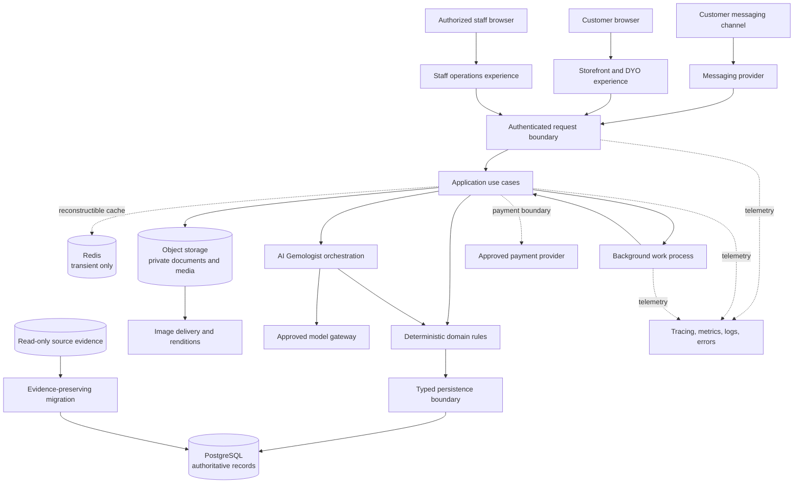
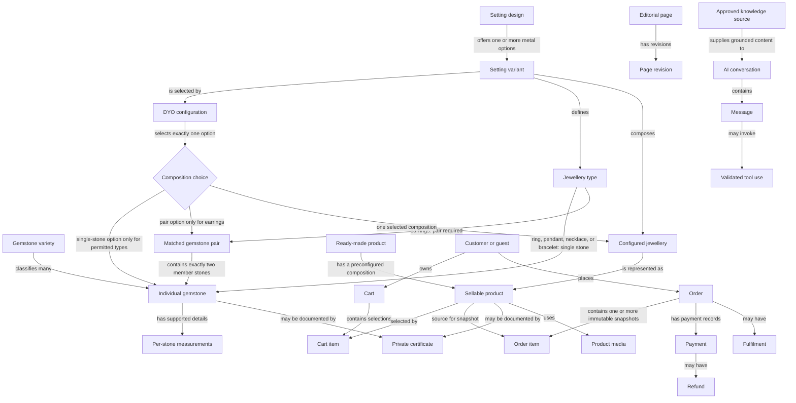
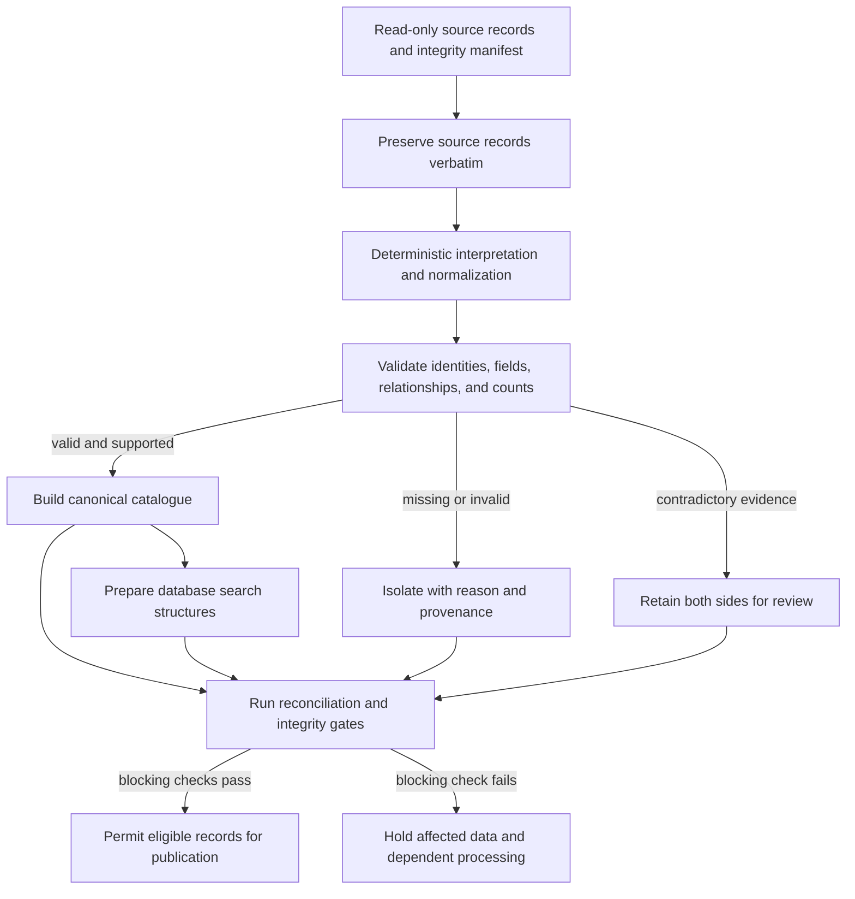
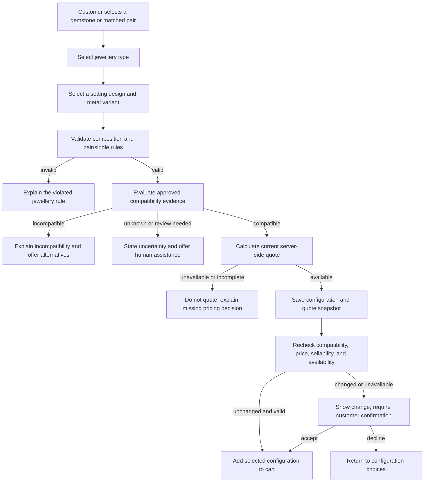
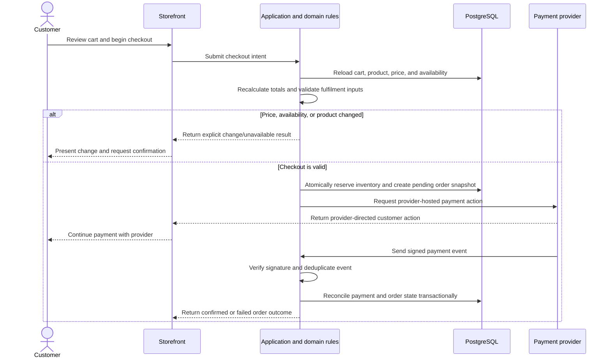
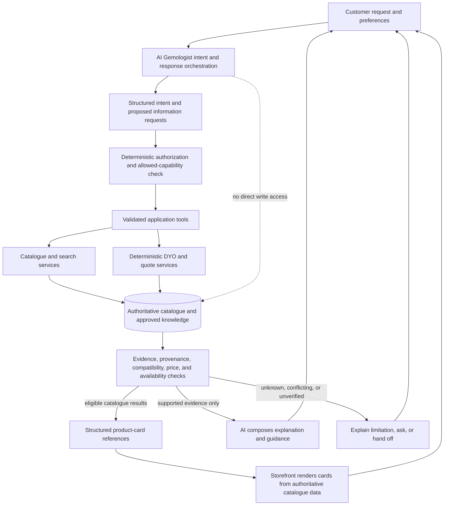
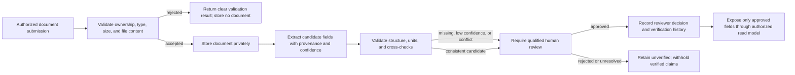

# Maihan Gems Technical Software Requirements Specification

- **Prepared by:** FKodelabs
- **Submitted to:** Maihan Group
- **Document version:** 1.2
- **Date:** 2026-10-08
- **Document purpose:** Client-facing functional and architecture specification.

> This document is prepared by FKodelabs for Maihan Group and is intended to
> support technical review, project planning, engineering alignment, and
> implementation governance for the Maihan Gems platform.

> This document describes the required system behaviour and the architecture
> through which each layer collaborates. It distinguishes source evidence from
> design requirements and identifies decisions that require client or
> technical approval.

## 1. Purpose and authority

### 1.1 Audience and purpose

This specification is for the CTO, technical architect, engineering and QA
leads, senior engineers, and DevOps/infrastructure engineers. It is the technical
index connecting business outcomes to functional behaviour, architecture, data,
interfaces, integrations, security, testing, deployment, and observability.

It complements the client-facing Maihan Gems SRS and defines how the platform's
presentation, application, domain, data,
integration, security, testing, deployment, and operations layers are expected
to work together.

### 1.2 Authority order

This specification is based on the approved business scope, validated source
evidence, and the project architecture decisions. If an unresolved business
or technical decision affects behaviour, the relevant section identifies it
for confirmation rather than assuming a value. Changes to the established
architecture require formal review.

### 1.3 Evidence terminology

The following labels describe the strength of statements about legacy source
data; they do not replace requirements for target platform behaviour.

| Label | Meaning |
|---|---|
| `OBSERVED` | Directly present in a source artefact. |
| `VERIFIED` | Observed and checked at scale with a recorded result. |
| `EXTRACTED` | Deterministically derived from source evidence. |
| `PATTERN` | Repeated structure; not by itself proof of causation. |
| `INFERRED` | A reasoned target proposal, not an observed source fact. |
| `INFERRED / PROPOSED` | A proposed design awaiting the required approval. |
| `UNKNOWN` | Not established by available evidence or an approved decision. |

Where a field has a value but its authority is not `VERIFIED`, it must not be
presented to customers or AI as verified truth. Missing evidence stays
`UNKNOWN`; it is not filled by similarity, a model, or a plausible default.

## 2. Product context and scope

Maihan Gems is a rebuild of a gemstone and fine-jewellery commerce platform.
`[OBSERVED]` The source site was a server-rendered Nuxt/Vue site with loose
gemstones, gemstone pairs, jewellery settings, configured jewellery, and
ready-made products. The target is a modular application that reconstructs the
catalogue from validated source evidence and adds new commerce, operational,
content, and intelligence capabilities.

### 2.1 User groups

| User group | Required capabilities |
|---|---|
| Shopper or guest | Browse, search, compare, configure, and purchase products. |
| Account customer | Manage profile, addresses, saved items/designs, and order information. |
| AI Gemologist user | Receive conversational gemstone guidance, catalogue-backed product cards, comparisons, and guided DYO assistance. |
| Catalogue/content staff | Review and maintain products, taxonomy, media, and editorial content. |
| Commerce/support staff | Review customer requests, orders, and fulfilment tasks. |
| Trust reviewer | Review document extraction and approve or reject trust-bearing claims. |
| Platform operator | Manage migration, deployment, background processing, and operational recovery. |

### 2.2 Scope and architecture boundary

The platform comprises a customer storefront, a staff-facing operational
experience, a modular application layer, an asynchronous work process, and
shared data and integration capabilities. Capabilities are delivered in
dependency order defined by the project plan; this SRS describes the complete
target behaviour without asserting delivery dates or release commitments.

The initial platform does not replace a full ERP or CRM, provide a loyalty
programme, or promise historical customer/order migration. WebAR depends on
approved 3D assets and fit data. Payment, tax, shipping, messaging, and
identity-provider behaviours require the corresponding business/provider
decisions.

Migration must use the validated source package as read-only input. Required
source evidence is not fabricated or substituted when unavailable.

## 3. Technology and runtime architecture

| Layer | Technology | Architectural responsibility |
|---|---|---|
| Web application | Next.js App Router, TypeScript, and Vercel Node runtime | Server-rendered storefront and staff experience, browser interaction, and request handling. |
| Workspace | pnpm | Consistent package and application dependency management. |
| Domain and contracts | TypeScript and Zod | Typed domain behaviour and validation of requests, events, and responses. |
| Relational persistence | PostgreSQL 16+ on Neon; Drizzle for database access and migrations | Durable transactional records, integrity constraints, and database access. |
| Database search extensions | pg_trgm, unaccent, citext, and pgvector | Typo-tolerant and normalized text search, case-insensitive text, and vector search within PostgreSQL. |
| Cache and transient coordination | Redis | Reconstructible cache and short-lived coordination only; never authoritative commerce state. |
| AI model boundary | Vercel AI Gateway with the approved provider strategy | Model invocation through an application-owned boundary; business rules remain outside the model. |
| Messaging channel | Meta WhatsApp Cloud API | Inbound/outbound customer messaging through the shared AI and application rules. |
| Media and documents | Cloudflare R2 and ImageKit | Object storage, private trust documents, image renditions, and public media delivery. |
| WebAR client | Three.js and MediaPipe | On-device rendering and hand tracking; camera frames remain on the device. |
| Observability | OpenTelemetry and Sentry-compatible error reporting | Correlated traces, metrics, structured logs, and application error reporting. |
| Testing | Vitest and Playwright | Unit/integration/contract and end-to-end verification. Load-test tooling is selected through a separate decision. |

Search uses PostgreSQL rather than a dedicated search service. The system is a
modular monolith with explicit domain boundaries and a separately scheduled
background-work process; it is not decomposed into invented microservices.

## 4. System architecture

### 4.1 Component responsibilities

| Layer/component | Responsibility |
|---|---|
| Storefront | Public brand, category, product, search, DYO, account, and purchase journeys. |
| Staff experience | Authorized catalogue, content, order, certificate, and operational workflows. |
| Request/API boundary | Authenticate requests, validate inputs, apply rate limits, invoke application use cases, and return stable response contracts. |
| Application services | Orchestrate use cases, authorization, transactions, idempotency, audit records, and domain events. |
| Domain layer | Enforce product composition, gemstone/setting compatibility, pricing rules, inventory policy, and lifecycle transitions deterministically. |
| Data-access layer | Persist and retrieve domain data through typed database operations; it does not decide business policy. |
| Asynchronous processing | Execute migration, media processing, AI-related background tasks, notifications, and integration work with retry and deduplication controls. |
| AI Gemologist | Interpret customer intent, call approved tools, ground claims, render catalogue-backed product suggestions, and hand off uncertain cases. |
| Integration adapters | Isolate payment, messaging, AI-provider, storage, and observability protocols behind application-owned boundaries. |
| PostgreSQL | Authoritative relational and transactional state, including orders, prices, inventory, audit, and trust records. |
| Redis | Reconstructible caching and transient coordination; loss cannot lose authoritative business facts. |
| Object/media storage | Validated public media and private customer/trust documents, with authorization at access time. |
| Migration pipeline | Deterministic, evidence-preserving import from source records into canonical catalogue data. |
| Operations/observability | Health, traces, metrics, structured logs, alerting, recovery, and release verification. |

### 4.2 Logical architecture



The request boundary, application use cases, and domain rules are logical
modules within the application architecture, not separate independently
deployed services. Background work is asynchronous and communicates through
durable application data/events. Cache loss, model/provider failure, or
messaging outage must not make transactional data unavailable or inconsistent.

### 4.3 Enforced dependency and request rules

1. HTTP handlers resolve identity, validate an input contract, invoke one
   application service, and serialize a DTO. They do not own business logic,
   SQL, transaction control, or price calculation.
2. Application services perform authorization and idempotency checks, invoke
   deterministic domain logic, persist through repositories, and write audit
   and outbox records in the transaction where required.
3. Domain code is pure and imports no database, framework, Redis, model SDK, or
   network I/O.
4. Cross-module calls use the owning module's public application surface.
5. Provider SDKs remain behind integration ports.
6. External protocols remain behind stable application contracts; business
   policy does not depend on a particular provider's request format.

## 5. Domain model

### 5.1 Core concepts

| Concept | Meaning and responsibility |
|---|---|
| Gemstone | One individually identifiable physical stone with its own supported gemological measurements and catalogue facts. |
| Gemstone pair | Two matched stones sold and configured together; member measurements remain individually represented. |
| Setting design | Reusable jewellery design independent of a particular metal selection. |
| Setting variant | A setting design offered in one defined metal option, with its own selectable catalogue identity. |
| Configured jewellery | A customer-selectable composition of exactly one setting variant and exactly one gemstone or gemstone pair. |
| Ready-made product | A preconfigured, independently identified sellable item. |
| Customer | A person or guest identity associated with permitted profile, address, cart, and order information. |
| Cart | A mutable collection of selections owned by a guest session or authenticated customer. |
| Order and order item | Durable transaction records; each item preserves the product, configuration, and agreed price facts at purchase time. |
| Inventory | Authoritative sellability and reservation information for unique stones/pairs and setting options. |
| Certificate/document | Private evidence associated with a gemstone or product, with extracted values, confidence, review, and verification history. |
| Media asset | An identified image or document with source, classification, processing state, access policy, and product usage. |
| Product/configuration price | A server-calculated amount with a reproducible component breakdown and immutable quote/order snapshot. |
| Tax, shipping, payment | External business capabilities integrated through application boundaries; rules and providers require approval. |

### 5.2 Logical entity relationships

The diagram describes conceptual business entities and cardinalities rather
than database object names. A configured product is constrained to one setting
variant and one, and only one, of a single gemstone or pair. A pair contains
two individual stone records. A ready-made product follows its own
preconfigured composition.



Source records, import batches, validation outcomes, conflict records, and
audit events are related operational evidence supporting the catalogue and
commerce entities above. They are not customer-facing product concepts.

### 5.3 Invariants

These invariants are requirements, not AI or interface suggestions. They are
enforced in deterministic domain rules and by relational integrity controls
at the persistence boundary.

| ID | Requirement |
|---|---|
| INV-01 | A configured jewellery product has exactly one setting variant and exactly one of a single gemstone or a gemstone pair. |
| INV-02 | A gemstone pair may be used only with earrings. |
| INV-03 | A single gemstone may be used only with rings, pendants, necklaces, or bracelets; configured earrings require a pair. |
| INV-04 | The canonical metal option determines its purity and colour; these are not independent free-text product identities. |
| INV-05 | Migrated variety evidence must agree with its source route; mismatch is isolated for review, not silently corrected. |
| INV-06 | Every price is reproducible from its recorded components, configuration, and pricing-rule version. |
| INV-07 | A document field not approved as verified is never presented as verified truth. |
| INV-08 | An inferred identifier is not treated as a confirmed external identity before review and approval. |
| INV-09 | A product URL remains stable; a rename requires an explicit redirect. |
| INV-10 | Financial, audit, trust, and event history is not silently deleted. |

## 6. Catalogue requirements

The catalogue has four structurally distinct product concepts, plus ready-made
items:

| Concept | Identity and relationship |
|---|---|
| Loose gemstone | Identified by its source-backed gemstone reference and modelled with individual stone details. |
| Gemstone pair | Identified by a pair reference and linked to its two separately measured stones. |
| Jewellery setting | Reusable design offered through explicit metal-specific variants. |
| Configured jewellery | A configuration of one setting variant and exactly one single gemstone or pair. |
| Ready-made product | Preconfigured product with its own source-backed product identity. |

### 6.1 SKU grammar and metal codes

```text
Setting:        JS<design><metalCode>
Configured:     JS<design><metalCode>-<K####|PR####>
Ready-made:     J<digits>
Gemstone:       K<digits>
Gemstone pair:  PR<digits>
```

The grammar is verified against the captured product sample with zero
mismatches. Deriving an identifier from a pattern never changes its evidence
classification to observed.

`OBSERVED` metal codes: `W10`, `Y10`, `W14`, `Y14`, `R14`, `W18`, `Y18`,
`R18`, `PT`, `SL`, `YW14`, `YW18`, `WY14`, `WY18`. `SL` means Sterling Silver
and `PT` means Platinum 950. A further rose-gold option exists in the target
reference vocabulary, but is not established by source product evidence.
Observed metal code-to-slug phrase mappings are one-to-one. No `R10` source
product or setting is established.

### 6.2 Identity, specifications, availability, price, and provenance

1. Preserve source URL and source identity evidence separately from normalized
   or derived identifiers.
2. Retain raw source specification text alongside normalized values;
   normalization must not destroy source values.
3. Keep per-stone weight and dimensions separate for a pair. Do not store
   concatenated pair values as a single measurement.
4. Use the complete URL inventory as the catalogue spine. The partial product
   export is not the complete catalogue and must never be the sole input.
5. Availability from old structured data is not a live inventory feed.
   Unknown or stale availability is never presented as confirmed in stock.
6. Money uses exact decimal representations and decimal strings at interfaces;
   binary floating point is prohibited in the pricing path.
7. A migrated value retains evidence status and traceability to its source
   location and import batch.
8. Public pages expose only approved, supported attributes; fields absent from
   evidence remain null/unknown.
9. Media metadata association does not imply the binary file was downloaded,
   validated, rights-cleared, transformed, or published.

## 7. Source migration and target data model

### 7.1 Authoritative source assets

| Source evidence set | Meaning | Must not be treated as |
|---|---|---|
| Complete URL inventory | `[OBSERVED]` Complete 44,218-URL inventory; migration spine. | A list that can be replaced by the partial product extract. |
| Structured specification records | `[OBSERVED]` 12,401 records and 13 field categories in the source analysis. | A complete specification feed for every catalogue entity. |
| Partial product extract | `[OBSERVED]` 1,245 crawler product records, primarily DYO records; useful observed SKU evidence. | The catalogue; 33,934 commerce URLs are absent from it. |
| Analyzed page records | `[OBSERVED]` Rich page analysis; only source for captured structured price/availability; 1,024 recovered prices. | A full inventory or a current price/availability service. |
| Analyzed media records | `[OBSERVED]` 241,961 metadata records with page-derived paths and URLs. | Proof of binary ingestion or valid role classification. |
| Source taxonomy analysis | `[OBSERVED]` Field distributions and values used for evidence-bound reference data. | A target vocabulary without provenance/review. |
| Crawler database | `[OBSERVED]` Historical crawler records governed by the evidence manifest. | A target business database or permission to alter source evidence. |
| Joined specification, URL, and page evidence | Supporting structured facts where matching records exist. | A guarantee that unmatched fields can be reconstructed. |

The evidence manifest records integrity digests and retention requirements.
Source inputs are read-only. Artifact verification must precede a consuming
stage; mismatch or missing data is a visible refusal, not a warning followed
by success.

### 7.2 Source completeness and evidence limits

| Finding | Status | Requirement implication |
|---|---|---|
| 44,218 total URLs; 33,934 commerce URLs absent from the partial product extract | `VERIFIED` | URL inventory drives reconstruction. |
| 1,245 product extract records (2.4% of commerce URL count) | `OBSERVED`/`VERIFIED` | Not a complete sellable catalogue. |
| 19,665 loose stones; 3,072 pairs | `VERIFIED` | Reconstruct identities from validated URL families, not from the partial export. |
| 951 designs; 10,349 setting variants | `VERIFIED` | Variants include 865 silver SKUs omitted by the earlier incorrect 9,484 count. |
| 9,812 DYO URLs; 1,024 observed SKU records and 221 derived-only identities | `VERIFIED` | Identity evidence remains separated; derived rows remain quarantined/draft. |
| 88 ready-made products | `OBSERVED`/`VERIFIED` | Separate product kind. |
| 1,024 recovered prices, USD; price is not weight × per-carat price in any of 1,024 cases | `VERIFIED` | No simple weight-based price inference or general price coverage claim. |
| Full details and structured fields are available only for a limited subset | `OBSERVED`/`VERIFIED` | Do not imply complete specifications for all entities. |
| A structured gemstone classification is present on 113 of 1,024 analyzed products; 911 are untyped | `VERIFIED` | AI and customer pages must withhold unsupported gemstone classification claims. |
| Original source page copy was not recovered in the evidence package | `OBSERVED` | Copywriting/content creation is a client/editorial dependency. |
| Media inventory has 241,961 records, including about 44,480 product media records | `VERIFIED` | Classification and actual asset ingestion are separate processes. |
| No production-ready setting catalogue 3D models | `VERIFIED` per technical design | WebAR must remain conditional on model production. |
| Source live inventory, payment provider, shipping rates, tax rules, and original CMS/backend | `UNKNOWN` | Require explicit business/CTO decisions; do not emulate guessed source behaviour. |

### 7.3 Staging, canonicalisation, conflicts, and idempotency

The migration flow separates source preservation, interpretation, validation,
canonical catalogue construction, search preparation, and release gates.



* The staging layer preserves the verbatim source record and provenance. No
  normalization belongs in extraction.
* Parsing is deterministic and versioned. Parsed values carry evidence status;
  malformed or contradictory records are quarantined or recorded in the
  conflict ledger.
* Canonical writes follow dependencies: taxonomy, stones/pairs, settings,
  variants, and products.
* Processing must be resumable, deterministic for identical inputs, and
  idempotent. A complete repeat run must produce zero changed rows.
* Source conflicts retain both sides and their URLs; they are not
  auto-resolved.
* A failed gate halts the pipeline or holds publication as its gate specifies.
  It may not silently drop records.
* Twenty-two validation gates cover parsing, source-to-target counts,
  identity, composition, provenance, conflict handling, media classification,
  publication safety, relationship integrity, and repeat-run idempotency. A
  failed blocking gate holds affected records and dependent processing.

### 7.4 Derived-only DYO identities

The 221 DYO identities that lack a directly observed SKU remain distinguishable
from observed products and are withheld from publication pending review:

| Attribute | Required treatment |
|---|---|
| Source identifier | Not populated when absent from evidence |
| Derived identifier | Recorded separately with parser provenance |
| Evidence classification | `INFERRED` |
| Publication state | Draft and unpublished |
| Unsupported attributes | Remain unknown and unpopulated |
| Publication | Only after explicit review/approval and audit |

The 221 identifiers are not source-observed SKUs. Do not infer attributes from
a sibling record, manufacture source identifiers, or imply that derivation
alone makes a row publishable.

### 7.5 Migration validation gate catalogue

Migration acceptance includes the following gate outcomes:

| Validation area | Assertion |
|---|---|
| Route parsing | Gemstone and pair routes follow their validated identity grammar. |
| Observed identifiers | Parsed identities agree with observed identifiers and introduce no collisions. |
| Variety and relationships | Source-derived variety agrees with catalogue assignment; mismatches are quarantined. |
| Product composition | Pair and single-stone use obey jewellery-type invariants. |
| Measurements | Pair member measurements reconcile with supported totals. |
| Referential integrity | Every setting, metal, product, gemstone, and pair reference resolves or is explicitly held. |
| Catalogue census | Counts reconcile by product family to the source inventory. |
| Publication safety | Unknown prices and inferred-only identities are not published. |
| Media classification | Scripts and unrelated site assets are not treated as product media or 3D models. |
| Provenance/conflicts | Source evidence remains traceable and both sides of conflicts are retained. |
| Idempotency | A complete repeat run changes no canonical records. |

## 8. Media architecture

### 8.1 Classification and identity

`OBSERVED` media records number 241,961 over five source hosts and 3,749 path
stems. The captured media-role annotation is unknown on most records and is not
a safe classifier.
The target classifier derives kind and role from the documented path-stem
mapping, preserves original metadata for provenance, and records an explicit
terminal disposition.

| Class | Required handling |
|---|---|
| Stone and setting photography | Classify and associate only by supported reference/path evidence. |
| Lifestyle, detail, and packaging imagery | Classify by role and associate only where source evidence supports it. |
| Certificates, SARIN reports, and appraisals | Treat as private documents, never public product images. |
| Video and genuine 360-degree media | Classify separately from scripts and unrelated site assets. |
| Navigation, logos, filters, and vendor assets | Mark as global, skipped, or otherwise dispositioned; do not imply product association. |
| JavaScript bundles misidentified as 3D/360 assets | Never treat as models or usable media. |

### 8.2 Asset pipeline

The target pipeline is: classify metadata, identify duplicates, inspect content
type/bytes, fetch only approved assets, validate actual content, remove
 sensitive EXIF, generate appropriate renditions, record asset usage and
renditions, and record a terminal outcome with a reason. A metadata record alone
does not prove any of those binary-ingestion steps occurred.

The architecture uses Cloudflare R2 for originals and private documents, and
ImageKit for public image delivery. Product imagery may be served publicly only after
asset validation and rights approval; certificates, reports, and appraisals
remain private and use authorized short-lived access.

## 9. Search and discovery

### 9.1 Search architecture

Search is a PostgreSQL capability within the application architecture:

1. Structured predicates for kind, taxonomy, gemstone attributes, jewellery
   type, style, metal, weight, price, certificate state, and availability.
2. PostgreSQL full-text search for lexical matching.
3. PostgreSQL trigram matching for typo tolerance where appropriate.
4. Diacritic normalization for consistent text matching.
5. Optional, gated PostgreSQL vector retrieval and reranking.
6. Deterministic business ranking and facet counts.

No dedicated search engine or separate vector database is part of the target
architecture. Search provider, synonyms, ranking, and filter precedence in
the original site are `UNKNOWN`; target ranking is a design requirement, not
reconstructed legacy behaviour.

### 9.2 Product-specific discovery

| Search family | Requirements |
|---|---|
| Loose gemstones | Filter by supported variety, colour, intensity, shape, cut, clarity, treatment, origin, weight, price, certificate, and availability fields; absent values do not become implied matches. |
| Gemstone pairs | Preserve pair identity and member-level details; pair weight is the sum of the member weights where known. |
| Setting variants | Filter by jewellery type, style, design, and metal; treat a variant as a metal-specific identity. |
| Configured jewellery | Search actual configured product rows; do not generate the full theoretical stone × setting cross product. |
| Ready-made products | Preserve their distinct identity and treat any source zero-weight placeholder as not a gemstone weight. |
| Product reference | Exact identifier matching is structured; a fuzzy search result must not silently substitute another product. |

Facets are computed against the filtered set and returned with results. Unknown
facet values are rejected or reported explicitly rather than silently widening
the result. Availability and price filtering use authoritative server-side
data, not stale client values. Sort options, filter contracts, and ranking
weights are defined as stable application contracts and verified against
representative catalogue queries.

### 9.3 Indexing and degradation

Search documents and indexes are maintained in PostgreSQL. Catalogue changes
must trigger the defined index and cache-invalidation mechanism. The semantic arm may be disabled when
unavailable; structured and full-text search must continue to function. A
vector failure must never turn into a fabricated product answer or a
transactional availability claim.

The performance requirements are filtered-search p95 below
400 ms; semantic reranking p95 below 800 ms. These are release targets, not
measured current performance.

## 10. Design Your Own (DYO)

### 10.1 Deterministic configuration behaviour

The DYO target consists of a persisted configuration aggregate over existing
catalogue entities, not a second product table or a generated catalogue. The
domain layer owns structural rules; UI and AI are clients of those rules.



### 10.2 Requirements

* Enforce the configured-product composition rules in deterministic domain
  logic and relational integrity controls.
* Do not allow the AI to decide or bypass compatibility, price, or inventory
  rules.
* Evaluate persisted compatibility rules deterministically. A missing rule
  means `UNKNOWN`/review, not compatible by default.
* Record rule-level outcomes and return explainable, machine-readable
  validation errors.
* Any change to selected stone, setting variant, or options invalidates prior
  validation/price state according to the DYO state machine.
* Generate product references only by the documented grammar; product
  identity and customer configuration identity remain distinct.
* Canonicalize configuration data deterministically. Sensitive free text such
  as engraving instructions is excluded from public links and identifiers.
* Persist durable configuration and price snapshots in PostgreSQL. Redis may
  accelerate transient interaction state but is not the only record.
* Before cart insertion, reload and revalidate current compatibility, price,
  product state, and availability. Price differences require explicit
  customer confirmation.
* Order placement stores an immutable configuration snapshot.

The source compatibility rules and original pricing algorithm are `UNKNOWN`.
Observed configurations can support extracted positive compatibility evidence;
absence of an observed combination is not evidence of incompatibility.

## 11. E-commerce requirements

### 11.1 Cart, checkout, and order boundaries

The target separates Cart, Checkout, Payment, Order, Fulfilment, and Inventory
responsibilities while keeping them in the modular monolith. The source
four-step cart/checkout URL funnel is `OBSERVED`; internal checkpoint semantics
and the payment provider are target design or `UNKNOWN`.



This sequence is a target boundary diagram, not a commitment to any provider
operation or a settled payment protocol.

### 11.2 Requirements

* Guest and account carts follow server-held ownership/session rules.
* Every add/update/checkout action reloads authoritative product and
  configuration state.
* The browser never supplies an authoritative total. Re-price at checkout;
  on a changed amount return the documented conflict and require consent.
* Idempotency applies to state-creating commands and webhook/worker effects.
  A replay returns or preserves the original outcome; it must not create a
  duplicate order, capture, refund, or fulfilment.
* Durable orders, payments, refunds, order events, and snapshots live in
  PostgreSQL. Redis must never be the authoritative order database.
* Order item snapshots preserve the product/configuration facts, price
  breakdown/rule version, and document references that were agreed at sale.
  Subsequent catalogue edits do not rewrite historical order facts.
* Payment provider integration stays behind a port. Card PAN/CVV do not pass
  through platform servers; provider-hosted fields are the target design.
* Webhook events are authenticated over the raw request body before parsing,
  deduplicated, persisted, and processed idempotently.
* Tax, shipping rates/carriers, discounts, order numbering, financing,
  protection plan mechanics, cancellations, and refund policy remain
  `UNKNOWN` or proposed until their owners decide them.
* Do not enable a production sale until payment, tax, shipping, inventory,
  and refund decisions and release gates are satisfied.

### 11.3 Inventory semantics

`OBSERVED` source pages reported an in-stock label for 1,024 products but
did not establish per-item live stock, counts, reservation, or backorder
behaviour. The target proposes Boolean availability for unique stones/pairs
and atomic reservation of both stones in a pair; reservation semantics remain
`INFERRED / PROPOSED` pending the relevant business approval.
Availability that is missing or stale is not represented as confirmed.

## 12. Admin and business operations

The staff experience uses the same application services, domain checks, and
authorization rules as customer-facing operations. It has no independent
privileged database path.

Target operation areas include catalogue/products, gemstones/pairs, settings
and variants, DYO/compatibility, pricing, availability, orders, customers
within approved scope, certificates, assets, CMS/SEO, migration batches and
conflicts, jobs, events, audit history, and operational dashboards.

Access is granted through a client-approved permission matrix. This SRS does
not assume named roles; the authorization design must define permitted actions,
data scope, and approval requirements for each staff responsibility.

Regardless of role naming:

* Authorization is enforced server-side in application services, not by hiding
  UI controls.
* All privileged mutations are attributable and audited with the relevant
  before/after state where the schema permits.
* Bulk changes have a preview, stale-version detection, explicit approval,
  per-record audit, and a bounded recovery path.
* AI-generated suggestions remain pending and cannot publish themselves.
* Migration conflicts and derived identities require a human review path.
* Analyst outputs must not expose customer PII.

## 13. CMS and content

### 13.1 Content model and workflow

The content layer manages pages, revisions, navigation, redirects, and SEO
metadata. Page blocks are validated against an approved content model; SEO and
navigation remain separate concerns. The publishing lifecycle supports draft,
review, publish, and archive states. Approval responsibilities and any
two-person review requirement for trust-bearing content are confirmed during
business workflow approval.

`OBSERVED` source routes include education, FAQ, blog, showroom, contact, team,
and policy/business routes. Original page copy was not recovered from source
evidence. New buying guides,
variety content, policy copy, certificate explanations, and localized content
must come from approved authorship, not from claims that original text was
migrated.

### 13.2 Publishing and AI corpus

Only published and explicitly eligible content can enter the customer-facing
knowledge corpus. Content trust tier and locale are explicit; republishing
reprocesses changed content only. Admin-only/customer-specific text is not
retrieved for public users. Generated marketing prose is not treated as
curated authoritative knowledge without human review.

The client supplies or approves content, brand, legal/policy material, and
testimonial or review assets. Only content approved for customer use may
support customer-facing knowledge answers.

## 14. AI Gemologist and orchestration architecture

### 14.1 Trust boundary and flow

The AI Gemologist is a prominent customer-facing product-discovery and guided
jewellery-design capability, not a generic FAQ/chat widget. It helps customers
express preferences, understand and compare gemstones, explore real catalogue
products, and work through a DYO design assembled from eligible catalogue
items. Its product-card and design experiences are grounded in catalog/search
results and deterministic application services. The model is not a database
client, system of record, source of gemological truth, or business-rule
authority.



The model never accesses persistence directly. Each proposed tool action is
authorized by application policy before execution. Tool inputs and outputs are
validated, and factual claims are grounded against trusted data before being
returned. Prompt instructions provide defence in depth only.

### 14.2 Customer-facing AI Gemologist behaviour

The customer experience shall support:

* **Conversational gemstone guidance:** use customer-stated preferences such
  as colour, style, occasion, or budget to identify useful next questions and
  search criteria. Advice about gemstone properties must come only from
  approved, appropriately trusted knowledge or structured catalogue fields.
* **Catalogue discovery and comparison:** retrieve actual products through
  approved catalogue/search tools, explain supported differences, and return
  structured product cards that the application renders from the returned
  product records. Cards link to the corresponding canonical product page and
  use its approved imagery and currently available data; they are never
  invented by the model.
* **Guided jewellery design:** translate customer preferences into
  suggestions among existing stones/pairs, setting designs, and metal
  variants, then assist with a DYO configuration. The deterministic DYO
  service—not the model—decides whether the composition is valid and whether
  a quote or availability result is authoritative.
* **Explainable next steps:** explain why an item or configuration was
  suggested using grounded attributes and deterministic compatibility
  outcomes. If source facts or compatibility are unknown, state the limitation
  and offer an approved alternative or human handoff.
* **Consistent channel behaviour:** where WhatsApp is enabled, it uses the
  same tool registry, evidence rules, product identities, and safety policy as
  the web experience; channel-specific setup remains a dependency.

The AI Gemologist is clearly disclosed as AI and must not imply that it is a
human or credentialed professional. It may assist with catalogue selection and
valid DYO assembly; it does not create a new sellable product, custom
manufacturing specification, jewellery image/render, 3D model, certificate
opinion, or authoritative product card. Generative visual design and
manufacturing-ready custom design are outside this defined scope unless
separately approved.

### 14.3 Technical requirements

* AI-assisted discovery and comparisons call read-only catalogue/search
  services; the model does not invent a result set, SKU, product identifier,
  image, specification, price, or availability claim.
* Product cards are structured references to actual catalogue results. The
  application renders card fields and approved media from authoritative
  services rather than accepting model-authored card data as truth. A card
  cannot claim a current price or availability unless the authoritative
  service supplies a current value.
* AI may guide DYO using existing catalogue entities but does not decide or
  bypass compatibility, generate authoritative prices, reserve inventory,
  persist a saleable product directly, or place/cancel/refund orders.
  Unsupported/custom combinations are reported as unknown or handed off.
* A null/unverified source field produces an explicit refusal or qualified
  unknown, not a guess. In particular, stone type, origin, treatment,
  availability, price, certificate authenticity, and per-stone values must
  follow their field evidence/verification state.
* Every factual product claim must resolve to an approved structured fact or a
  cited, appropriately trusted document. Unsupported claims are removed; if
  that makes the answer misleading, refuse or hand off.
* Retrieved product/content/certificate text is untrusted data, never
  executable instructions or authority to broaden permissions.
* Preserve provenance and confidence through the tool response and any
  customer-facing answer.
* Tool calls and outcomes are authorized, bounded, schema-validated,
  idempotent where they mutate, and observable without logging secrets or
  unnecessary PII.
* The accepted registry contains no mutating tool for price, inventory,
  orders, payments, certificates, or permissions. Its only documented
  mutations are customer-request creation and human handoff, through normal
  application services and the same authorization controls.
* AI failures degrade AI features only. Catalogue and commerce correctness do
  not depend on model availability.

Model selection, provider fallback policy, approved knowledge corpus,
evaluation thresholds, and usage budgets require agreement. Model traffic
passes through the Vercel AI Gateway boundary; any alternate provider requires
the applicable approval.

## 15. Certificate intelligence

### 15.1 Evidence and pipeline

Certificate, SARIN-report, and appraisal artefacts are `OBSERVED` by path
convention. Their contents, lab identity, schema, numbers, dates, authenticity,
and field completeness are `UNKNOWN`; the crawler database has no document
rows. The target proposes a secure upload/ingest and extraction pipeline:



### 15.2 Requirements and limitations

* Treat every extracted field as a proposal with field-level confidence,
  provenance, extractor/model version, and verification status.
* Extraction is not approval. Human review is required before material
  certificate claims are presented as verified.
* Compare extractable values with structured gemstone/per-stone values and
  record anomalies; do not silently overwrite catalogue data.
* Keep documents private; authorize access before issuing short-lived URLs.
* A failed, missing, or uncertain extraction remains `UNKNOWN`/unverified.
* Do not promise extraction accuracy, supported certificate formats, or
  automatic verification until those behaviours are agreed and validated.

The exact schema, supported document set, extraction provider, confidence
threshold approval, reviewer roles, retention, and escalation ownership are
technical/business dependencies.

## 16. WhatsApp integration

Meta WhatsApp Cloud API is the designated messaging channel. Business account
access, credentials, templates, and consent policy are client dependencies.

The target integration is a transport adapter over the same AI orchestrator,
tool registry, grounding gate, and knowledge corpus used on the web. It must
not become a second AI brain. The webhook boundary must verify the provider
signature over the raw body before parsing; deduplicate external event
identities; acknowledge safely; enqueue processing; and persist message,
conversation, tool, and handoff outcomes under the same privacy/audit rules.

Inbound/outbound message constraints, identity mapping, consent, templates,
rate limits, retries, idempotency, retention, agent escalation, and customer
data mapping follow the approved channel and policy decisions. This SRS does
not prescribe provider-specific endpoint names.

## 17. WebAR and 3D

Three.js, browser-side MediaPipe, and client-side rendering form the WebAR
foundation. Camera frames remain on-device; camera
permission is requested only after explicit user action. Product viewing must
continue when camera, WebGL, WebAssembly, tracking, network, or compatible
models are unavailable.

The source contains no production-ready 3D setting catalogue models. Apparent
3D/360 records include misclassified JavaScript assets; actual 360 video
metadata does not provide compatible GLB models. Do not promise or represent
951 completed models. The quantity, modelling/retopology process, fit metadata,
asset rights, supported jewellery classes/devices, and production budget are
dependencies requiring agreement. WebAR remains conditional on suitable assets
and must have a non-AR fallback.

## 18. SEO and URL migration

`OBSERVED` source inventory: 44,218 URLs. The platform must preserve route value
through a complete route map: a source URL either resolves directly or maps to
an appropriate redirect target that resolves. Redirects must not point
unrelated product pages to the homepage; avoid chains and loops; retain or
explicitly map query parameters whose meaning is unknown.

Target SEO requirements:

* stable canonical URLs and product slugs; a slug change creates a redirect;
* metadata generated from approved content and structured facts only;
* sitemap entries only for canonical, publishable routes;
* robots rules exclude private/admin/API flows;
* structured data never promotes inferred/unverified values;
* every source URL is covered by automated route/redirect reconciliation;
* a source query parameter with unknown semantics is not silently discarded.

Exact mappings must be reconciled against all 44,218 source URLs before release.

## 19. Security requirements

The following controls define the security requirements for the platform.
They do not imply any certification or regulatory attestation.

| Area | Requirement |
| Authentication | Use a managed identity provider; provider choice remains `UNKNOWN`. No local password store is part of the approved target. |
| Authorization | Enforce least privilege in application-service policies; database RLS is defence in depth. Do not trust client-supplied role/ownership. |
| Sessions | Secure, HttpOnly, SameSite cookies and server-side ownership checks for guest/customer data; identity-provider and session policy require agreement. |
| Secrets | Platform secret manager only; never repository, database/config, log, trace, client bundle, or fixture. Production credentials stay out of non-production. |
| Encryption | Use platform/database/storage transport and at-rest controls as provided by the approved services; exact key management/retention details require environment approval. |
| Input validation | Strict typed validation at external boundaries; reject unsupported fields and malformed values. |
| Data-access safety | Use parameterized, typed database operations; any database-specific query is reviewed and never constructed by concatenating untrusted input. |
| XSS/content | Escape rendered text; typed CMS blocks; no unsanitized raw HTML or script. |
| CSRF | Apply the approved cookie and request-origin protections to state-changing browser requests. |
| Upload | Presigned upload path, generated storage keys, MIME/content sniffing, size limits, scanning, and private handling for trust documents. |
| Webhooks | Verify HMAC/signatures over raw bytes before parsing; deduplicate and process idempotently. |
| Payments | Do not receive PAN/CVV; ignore client-supplied amounts; reconcile against server-side order snapshots and provider-confirmed events. |
| AI | Fixed tool registry; authorization outside model; least-data context; retrieved text treated as untrusted; no direct DB access. |
| Rate limits | Apply per-identity, network origin, and channel policies; abuse-sensitive actions fail closed if protection cannot be enforced. Thresholds require approval. |
| Audit | Privileged changes carry actor/action/entity and appropriate before/after details; append-only audit/trust ledgers have no application delete path. |
| Privacy | Minimize PII; do not put PII in metrics labels, embeddings, or model context beyond approved need; redact telemetry. |
| Least privilege | Separate environment credentials and provider permissions; avoid broad data-access grants. |

No SOC 2, PCI, ISO, GDPR, or other certification/compliance assertion is made
by this SRS. Applicable jurisdictions and legal retention requirements remain
`UNKNOWN` until approved.

## 20. Non-functional requirements

Numerical values below are project targets; they are not measured service
results. Where no numeric target is established, it is marked for approval.

| ID | Requirement / target | Acceptance evidence |
|---|---|---|
| NFR-01 | Design for approximately 50,000 users without premature microservices; this is a design-scale assumption, not measured capacity. | Scenario-based load testing; tooling and final profile require approval. |
| NFR-02 | Product/category LCP p75 < 2.5 s; WebAR must not regress storefront LCP. | Real-user and controlled browser measurements. |
| NFR-03 | Filtered-search p95 < 400 ms; semantic reranking p95 < 800 ms. | Representative search and load tests. |
| NFR-04 | Price, availability, and order state are not served from a cache that can diverge from PostgreSQL. | Cache-boundary and failure-mode tests. |
| NFR-05 | AI cannot mutate transactional state except through the explicitly permitted application-service actions. | Authorization, architecture-boundary, and behavioural tests. |
| NFR-06 | AI does not emit unsupported or unverified gemological facts. | Field-level grounding and refusal evaluation. |
| NFR-07 | Certificate extraction confidence and review status are preserved; no silent promotion to verified truth. | Document-flow and public-read tests. |
| NFR-08 | Every migrated field has traceable provenance and evidence. | Provenance reconciliation across source and target records. |
| NFR-09 | PII does not enter logs, metric labels, embeddings, or model context beyond the approved minimum. | Automated privacy and data-flow review. |
| NFR-10 | Webhooks validate signatures before processing or parsing. | Forgery, replay, ordering, and idempotency tests. |
| NFR-11 | Customer documents are private and public assets cross approved object-delivery boundaries. | Access-control and public exposure tests. |
| NFR-12 | Migration is repeatable and idempotent; a complete repeat run causes zero row changes. | Full-corpus repeat-run comparison. |
| NFR-13 | Every reconstructed feature has an evidence-linked test. | Traceability from requirement to test case and validation evidence. |
| NFR-14 | Catalogue/search remain usable when AI, cache, or vector search is unavailable. | Dependency-failure and graceful-degradation tests. |
| NFR-15 | No capacity claim is made without approved load-test evidence. | Reviewed load profile and retained test report. |
| NFR-A11Y-01 | Public journeys target WCAG 2.2 AA and full keyboard operation, including DYO; no colour-only meaning. | Automated scans plus manual assistive-technology review. |
| NFR-A11Y-02 | LCP p75 < 2.5 s, INP p75 < 200 ms, CLS p75 < 0.1 are documented performance/accessibility targets. | Real-user and lab measurement. |
| NFR-COMPAT-01 | Browser/device support matrix is confirmed and tested before acceptance. | Approved support matrix and compatibility suite. |
| NFR-REC-01 | Recovery objectives, backup retention, and restore frequency are approved before production. | Approved recovery plan and restore rehearsal. |
| NFR-AVAIL-01 | Service availability objective is agreed before production; no unapproved SLA is implied. | Approved service objective and operating model. |

## 21. API and integration requirements

### 21.1 API boundary

The application exposes stable domain-oriented contracts through the web
request boundary. This SRS defines behaviours and contract responsibilities,
not provider-specific endpoint names or wire-level route paths.

| Domain | Purpose | Required boundary behaviour |
|---|---|---|
| Catalogue/taxonomy | Public read models for product families and facets | Validate filters; return evidence/provenance as designed; do not expose internal rows. |
| Search | Search, suggestions, filtering, comparison | Whitelist filters; expose rejected filters explicitly; no silent widening. |
| DYO | Create/update/validate/quote/resume configuration | Deterministic invariant/compatibility service; idempotency on state creation; current server-side price. |
| Commerce | Cart, checkout, orders, payments/refunds | Authorization, idempotency, authoritative reprice, transaction boundary, durable snapshots. |
| Account | Profile, addresses, saved items, order history | Identity-to-customer mapping; ownership policy; RLS defence in depth. |
| CMS/assets | Published page reads and authorised content/asset operations | Schema-validated content, private docs, signed access, audit. |
| AI | Conversation and tool orchestration | Fixed tool schemas, policy before execution, evidence-grounded results. |
| Certificates | Upload, status, extraction/review | Private access, explicit confidence/status, human verification. |
| Admin/operations | Reviewed administrative commands and read models | Policy enforced in services; every privileged action audited. |
| Webhooks | Provider event ingress | Raw-body signature verification, dedupe receipt, quick acknowledgement, asynchronous idempotent processing. |

### 21.2 Contract standards

* Every external input has a typed validation contract; output DTOs are not raw
  database rows.
* AuthN and authorization are distinct. The owning application service is the
  final authorization boundary.
* State-changing operations use idempotency keys or a documented natural-key
  equivalent.
* Multi-row business commands define one transaction boundary. Events are
  written to the transactional outbox in the same transaction as the change.
* Errors are machine-readable and map validation, authorization, not-found,
  conflict, domain, rate-limit, and dependency failures distinctly.
* Payment, inventory, and authorization failures fail closed.
* Provider-specific APIs are behind ports; only providers and integrations
  documented as approved may be considered, and provider selection remains
  open where listed in §28.

### 21.3 Integration boundaries

| Integration boundary | Responsibility and interaction |
|---|---|
| Relational database | Transactional records, referential integrity, full-text search, and vector search. |
| Cache | Reconstructible read acceleration and transient coordination only. |
| Web runtime | Server-rendered public/staff experiences and validated request handling. |
| Media storage and delivery | Private originals/documents, approved renditions, and public image delivery. |
| AI model gateway | Model generation and embeddings behind an application-owned policy boundary. |
| Messaging channel | Signed, deduplicated inbound events and controlled outbound replies through the shared AI/application flow. |
| Payment provider | Authorization, capture, refund, and signed event boundary; provider requires business approval. |
| Tax, shipping, and email | Transactional/fulfilment calculations and notifications; rules and providers require approval. |
| Certificate extraction | Private document intake, candidate field extraction, deterministic validation, and human review. |
| Observability | Correlated traces, metrics, structured logs, and error reporting with approved operational backends. |

## 22. Error handling and unknowns

Errors must be explicit and must not be converted into success-shaped
fallbacks. The target distinguishes:

| Condition | Required behaviour |
|---|---|
| Invalid input / unknown filter | Reject with validation detail; do not silently broaden. |
| Missing product/configuration | Return an explicit not-found outcome. |
| Invalid DYO combination | Return invariant/compatibility outcome with deterministic rule details. |
| Compatibility not established | Return `UNKNOWN` or identify that expert review is required; do not guess. |
| Price unavailable/unverified/changed | Refuse the quote or require customer confirmation of a changed price; never estimate from weight. |
| Inventory unavailable/stale | Return unavailable/unknown; never claim current availability from old evidence. |
| Payment failure | Preserve provider result and durable order state; do not claim successful payment. |
| Duplicate webhook/job/command | Return/deliver idempotent outcome; no duplicate side effect. |
| Migration mismatch/conflict | Stop or quarantine per gate; preserve both source sides and details. |
| Missing source artifact | Stop the data-dependent stage; do not fabricate a replacement. |
| AI/provider failure | Disable/degrade AI response and offer approved handoff; do not affect catalogue/commerce truth. |
| Certificate extraction failure | Keep the document unverified; expose no extracted value as verified. |
| Media failure | Record a terminal failure or skip with reason; do not imply the asset is usable. |
| External integration failure | Surface bounded retry/failure; do not silently switch to an unapproved provider or path. |

`UNKNOWN` is a valid outcome, not an exception to be patched with an inferred
value. User-facing recovery messages may be helpful but cannot change the
underlying evidence state.

## 23. Observability

The observability architecture uses OpenTelemetry-compatible traces and
metrics, structured PII-safe logs, and Sentry-compatible error reporting.
Specific metrics backends, collectors, alerting vendors, and dashboards are
selected through environment and operations approval.

Requirements:

* Propagate a trace identifier across request, command, job, tool call, and
  event boundaries.
* Emit structured events and errors without secrets or unnecessary PII.
* Do not use customer identity, email, product identifier, or full URL as
  metric labels.
* Record migration artifact hashes/counts, stage state, rejected/quarantined
  rows, gate results, and idempotency delta.
* Record AI model/tool identifiers, latency, token/cost metrics, grounding,
  refusals, and handoff metrics without retaining unnecessary raw prompts or
  PII.
* Track integration/webhook rejection, duplicate, failure, and processing lag.
* Alert thresholds must derive from approved SLOs; every alert has an assigned
  owner and a runbook before operational release.
* Telemetry failure must not block transactional requests.

## 24. Testing strategy

Use Vitest for unit, integration, and contract tests; use Playwright for
browser end-to-end journeys. Database-specific behaviour is verified against
a real disposable PostgreSQL database, not only mocks. Select and approve a
load-test tool and test profile before performance acceptance.

| Test layer | Requirement |
|---|---|
| Unit/domain | SKU grammar, evidence values, product composition, configuration identity, DYO state machine, exact money, compatibility, and source parsers. |
| Database | Fresh schema fidelity; all business invariants reject invalid writes; row-access scope; transaction and numeric semantics. |
| API/contract | Strict input/output validation, authorization, error mapping, idempotency, rate limits, and contract documentation consistency. |
| DYO | Invariant failures; absent compatibility → unknown; quote reproducibility; stale quote/price conflicts; pair-specific rules. |
| Migration | Artifact integrity refusal; verbatim staging; source-to-target reconciliation; conflict/quarantine counts; identity/count/provenance validation; idempotent repeat run. |
| Search | Exact SKU and structured queries; filter/facet consistency; typo/synonym behaviour; deterministic ranking; vector outage degradation. |
| Checkout | Four source funnel checkpoints represented in user journey; server reprice; tamper rejection; reservation concurrency; order snapshot immutability; payment/webhook idempotency. |
| Security | Cross-customer access, authorization matrix, SQL injection, XSS, CSRF, SSRF, upload validation, webhook forgery/replay, audit completeness, AI mutation attempts. |
| Accessibility | WCAG 2.2 AA checks, keyboard-only purchase and DYO journeys, text labels, contrast, reduced motion, screen-reader status. |
| E2E | Critical storefront, account, purchase, DYO, certificate/staff review, and WhatsApp handoff journeys. |
| Regression | Permanent fixtures for identified source-data defects and every migration acceptance gate. |
| Release smoke | Read-only catalogue/SEO/health checks and a controlled checkout/payment journey under the approved operations procedure. |

Acceptance is based on executed test suites and data checks in the environment
appropriate to each release decision.

## 25. Migration validation and idempotency

The source-to-target reconciliation must cover:

1. Integrity digests for every source artefact before use.
2. Source URL count and URL-family parse/count reconciliation.
3. SKU observed-versus-derived separation, exact parser match, and collision
   detection.
4. Catalogue entity counts, setting design × metal variants, and cross-entity
   references.
5. Per-stone values and pair sums.
6. Price evidence recovery for the 1,024 captured records and non-zero
   residual checks; no extrapolated publication.
7. Media classification by path stem, explicit JavaScript/chrome
   disposition, duplicate/idempotent asset identity, and a separate report
   of binary ingestion state.
8. Certificate artefact records remain unverified and do not contain unsupported
   populated document fields.
9. URL mapping/canonical target completeness over all 44,218 source URLs.
10. Field evidence/provenance and import-run linkage.
11. Conflict ledger counts and disposition; no unresolved conflict is
    silently resolved.
12. A complete rerun with zero data changes, distinct from a process that
    merely skips already-successful stage records.

Migration writes are resumable and stage-scoped. A failure records its stage
and reason, prevents downstream stages from completing, and allows an operator
to resume only after correcting the cause. Any destructive schema change
follows forward-only expand/contract discipline; data rollback/recovery
boundaries are documented before production rehearsal. Validated source
evidence remains unchanged by migration.

## 26. Deployment and environments

| Environment | Intended role | Data/guard |
|---|---|---|
| Local development | Application and migration development | Local PostgreSQL/dev fixtures; do not target production. |
| Test / CI | Lint, typecheck, package tests, schema fidelity | Disposable PostgreSQL; synthetic customer data. |
| Preview | Per-change review and migration verification | Isolated environment and synthetic data; no production credentials. |
| Staging | Production-shaped migration/load/AI rehearsal | Anonymized or synthetic data and production-like controls. |
| Production | Live customer/commerce system | Access, release approval, and operational ownership are controlled. |

Requirements:

* Environment-specific database connectivity is supplied through protected
  configuration; the application refuses environment/database mismatches.
* Secrets come from a platform secret manager and are separated by environment.
* Migrations are serialized, forward-only, and tested against clean PostgreSQL
  16+ before release. No production access/migration occurs without explicit,
  current approval.
* Automated delivery checks block type, boundary, test, and schema-fidelity
  failures.
* Release policy, rollback, and progressive-deployment thresholds are agreed
  before production operation.
* Platform/provider-specific infrastructure follows the approved architecture
  and formal change control.

## 27. Backup, recovery, and data integrity

PostgreSQL is transactional truth. Redis and derived search/embedding/media
variants are reconstructible only where their source-of-truth rules explicitly
allow. Orders, payment records, audit history, trust decisions, and provenance
must not rely on Redis or ephemeral job state.

| Area | Requirement |
|---|---|
| Database backup | Use approved PostgreSQL backup capability with agreed scope, retention, and schedule. |
| Restore | Rehearse restoration on a non-production target before launch. |
| Recovery objectives | Agree recovery-point and recovery-time objectives, backup retention, and restore frequency before production. |
| Migration recovery | Preserve stage state, input integrity, counts, and failure reason; support idempotent replay and retain source evidence unchanged. |
| Transaction integrity | Commit domain changes and corresponding durable events atomically; enforce invariants at the persistence boundary. |
| Audit/trust history | Preserve append-only history and immutable order/configuration snapshots. |
| Cache loss | Rebuild cache from PostgreSQL; do not lose authoritative order, payment, price, or inventory facts. |
| Object/media loss | Agree recovery source, replication, and retention for media and private documents. |

## 28. Technical decision register

| ID | Decision | Status | Impact | Owner |
|---|---|---|---|---|
| ADR-001 | PostgreSQL is transactional source of truth | Accepted | Database, search/vector placement, commerce consistency | FKodelabs architecture |
| ADR-002 | Redis is cache/transient state only | Accepted | No authoritative orders, payments, price, or inventory in Redis | FKodelabs architecture |
| ADR-003 | AI cannot mutate transactional state except controlled application-service actions | Accepted | AI tool boundaries and business-data protection | FKodelabs architecture |
| ADR-004 | WebAR processing is client-side | Accepted | Camera privacy and browser/device fallbacks | FKodelabs architecture |
| ADR-005 | DYO is a configuration domain, not a product-table explosion | Accepted | Catalogue identity and DYO persistence | FKodelabs architecture |
| ADR-006 | No dedicated search engine at launch | Accepted | PostgreSQL search strategy | FKodelabs architecture |
| ADR-007 | The complete URL inventory, rather than the partial product extract, is the migration spine | Accepted | Migration completeness | FKodelabs migration |
| ADR-008 | Derived identifiers are separate and gated | Accepted | Inferred identities remain unpublished pending review | FKodelabs/catalogue owner |
| ADR-009 | Per-stone measurements are normalized | Accepted | Pair correctness and certificate cross-checks | FKodelabs domain design |
| ADR-010 | Unknown price components are explicitly represented | Accepted | Pricing review and publication gate | Maihan Group commerce |
| ADR-011/012 | Certificate artefact existence is ingested; low-confidence extraction is never verified truth | Accepted | Trust review and customer-facing certificate details | Joint trust owner |
| ADR-013 | Web and WhatsApp share one AI Gemologist experience | Accepted | Shared tools, refusal, and review behaviour | Joint AI/integration owner |
| ADR-014–017 | Normalized taxonomy; route-preserving redirects; evidence-led media classification; exclusion of non-authoritative artefacts | Accepted | Migration and catalogue model | FKodelabs architecture |
| ADR-018 | One embedding model/dimension at a time | Accepted | Search/knowledge re-indexing | FKodelabs search/AI |
| ADR-019 | Modular monolith with explicit extraction triggers | Accepted | Deployment and module boundaries | FKodelabs architecture |
| ADR-020 | Transactional outbox for reliable asynchronous side effects | Accepted | Integration consistency | FKodelabs architecture |
| ADR-021 | Vitest for automated tests, with Playwright for browser journeys | Accepted | Test tooling and acceptance | Joint engineering |
| ADR-022 | Build design-system primitives within the product design | Proposed | Frontend dependencies and UI delivery | Joint product/engineering |
| ADR-023 | First-party AI evaluation harness | Proposed | AI release gates and evaluation | Joint AI/engineering |
| ADR-024 | Field-level provenance relational design | Proposed | Migration evidence coverage | Joint data/engineering |
| DEC-04 | General pricing rules beyond captured evidence | Open/client decision | Catalogue publication and checkout | Maihan Group commerce |
| DEC-14 | Original content and approved new content | Open/client dependency | CMS and launch content | Maihan Group editorial |
| DEC-15 | 3D model production scope and cost | Open/client decision | Conditional WebAR launch scope | Joint product/3D owner |

## 29. Risks and technical dependencies

| Risk / dependency | Impact | Likelihood | Mitigation | Dependency / owner |
|---|---|---|---|---|
| Captured prices cover only a subset; they are not a general approved price list | No safe price coverage for much of the catalogue; checkout cannot be enabled for unpriced items | UNKNOWN | Preserve evidence, do not extrapolate, obtain reviewed price rules and gate publication. | Maihan Group finance/commerce |
| Specification gaps, including 911/1,024 records without structured stone type and unknown broader attributes | Incomplete product details, filters, and AI responses | UNKNOWN | Preserve unknowns/evidence; review workflow; AI grounding/refusal tests. | Catalogue owner / Maihan Group gemologist |
| Original source page copy is unavailable in the migration evidence | Editorial pages and the knowledge base require approved content | Likelihood UNKNOWN | Agree content inventory, authorship, and review. | Maihan Group editorial |
| Production-ready 3D models are not available for the complete setting catalogue | WebAR requires product models and fit data in addition to runtime engineering | Likelihood UNKNOWN | Treat WebAR as conditional; scope model production and fit data separately. | Joint product/3D owner |
| Payment, tax, shipping, email, and refund decisions are open | Checkout/fulfilment cannot be safely enabled | UNKNOWN | Decide provider/business rules before corresponding release gate. | Maihan Group commerce/finance |
| Source conflicts, duplicates, parser edge cases, and derived identities | Incorrect canonical data or accidental evidence promotion | UNKNOWN | Integrity-gated deterministic pipeline, conflict ledger, validation gates, human review. | FKodelabs migration |
| Media records do not prove usable binaries or usage rights | Missing/invalid imagery or private-document disclosure | UNKNOWN | Classify metadata separately from ingestion; content validation, rights approval, private access tests. | Maihan Group asset owner / engineering |
| Load-test tool and profile require approval | Performance/capacity requirements cannot be evidenced without an agreed method | UNKNOWN | Agree tooling and test profile before performance acceptance; make no capacity assertion without results. | Joint engineering |
| Third-party services/provider availability and policy changes | Channel/storage/AI/payment capability or cost changes | UNKNOWN | Provider boundaries, explicit configuration and failure handling; no unapproved fallback. | Joint technical and provider owners |
| Scope and sequencing questions affect dependencies | Work could proceed against incompatible assumptions | Open decision | Agree precedence and update the relevant acceptance gates before affected work. | Joint project/technical owners |
| Recovery objectives and operational recovery plan require agreement | Recovery capability cannot be assured | UNKNOWN | Define objectives and rehearse restore before production release. | Joint operations owners |

## 30. Traceability model

These representative mappings cover high-consequence business outcomes without
duplicating all requirements from the client SRS.

| Business requirement | Functional requirement | Technical requirement | Component/module | Verification |
|---|---|---|---|---|
| Trustworthy product discovery | Catalogue/search returns only supported attributes and distinguishes unknowns | Evidence status/provenance preserved; filters do not infer absent facts | Catalog, taxonomy, search | V1–V14; provenance tests; search/facet tests |
| Correct gemstone-pair jewellery | Pairs are used only for earrings; single stones follow allowed jewellery types | INV-01/02/03 enforced in domain and DB | Domain, catalog, DYO | Constraint bite tests; 113/113 pair evidence reconciliation |
| Reconstruct catalogue comprehensively | Catalogue covers source families rather than partial DYO export | Complete URL inventory is the migration spine; deterministic interpretation, conflict handling, and reconciliation | Migration, catalogue | V14 counts; V17 idempotency; full-source reconciliation |
| Avoid false prices/stock claims | Customer sees current approved price/availability or an explicit unknown | PostgreSQL is authoritative; reprice/recheck at checkout; no cache truth | Pricing, inventory, commerce | Price tamper/reprice tests; availability freshness tests |
| Safe order lifecycle | Customer can submit a purchase without duplicate or mutable historical facts | Idempotent commands/webhooks; immutable order snapshots; transactional outbox | Commerce, integrations, operations | Checkout E2E; replay and snapshot tests |
| Guided DYO | Customer can configure only established combinations | Deterministic compatibility, configuration hash, versioned snapshots | DYO/domain/pricing | Invariant and lifecycle tests; unknown compatibility case |
| AI Gemologist guidance | Customers receive grounded gemstone guidance, actual product cards, comparisons, and guided valid DYO choices | Structured catalogue references; deterministic search/DYO/price services; explicit unknown/refusal and AI disclosure | AI orchestration, catalogue/search, DYO, storefront | Product-card source-reference tests; DYO invariant tests; grounding/refusal, disclosure, and prompt-injection evaluations |
| Certificate trust | Certificate claims are not represented as verified before review | Per-field extraction provenance/confidence and approval ledger | Certificates/assets/admin | Confidence-band, public-read, reviewer audit tests |
| Preserve source web value | Legacy routes remain resolvable | Explicit route map, canonical/redirect integrity | CMS/SEO/migration | All 44,218 URL reconciliation; no chain/loop tests |
| Protect customer data | Customer data is scoped and private | Application authorization + RLS + no PII telemetry | Customers/auth/operations | Cross-customer, RLS, PII scan |
| Operationally diagnosable service | Staff can detect failures and recover safely | OTel signals, migration state, alerts/runbooks | Observability/operations | Trace propagation and alert/runbook checks |
| Accessible, performant shopping | Keyboard/screen-reader customers can complete core purchase journey | WCAG 2.2 AA plus LCP/INP/CLS targets | Web/storefront | Automated and manual accessibility; Lighthouse/real-user metrics |

## 31. Technical acceptance criteria

Acceptance is determined from the specified tests, reconciliation evidence,
and release approvals for each relevant capability.

| Area | Technical acceptance |
|---|---|
| Catalogue | Source-family identities and counts reconcile to validated evidence; all published facts carry supported status; no cross-product fabricated inventory. |
| Migration | All consuming artefacts pass manifest SHA-256; V1–V22 pass with their documented block/hold semantics; V17 confirms zero changes on a second full run; 221 records satisfy V18/V20. |
| DYO | INV-01/02/03 pass domain and database tests; unknown compatibility is not compatible; quote and configuration snapshots are reproducible. |
| Search | PostgreSQL search arms produce tested filters/facets; NFR-03 measured on approved test profile; vector outage leaves structured/lexical behavior. |
| E-commerce | Current server-side price and inventory checks; immutable order snapshots; idempotency; verified provider callbacks; external payment/tax/shipping decisions approved. |
| Admin | Every mutation passes a server-side policy and audit test; the client-approved authorization matrix and bulk preview/concurrency controls are verified. |
| CMS | Typed page blocks; revision/publish controls; source content gaps closed by approved content; SEO canonical/redirect constraints validated. |
| AI Gemologist | Conversational preference-led discovery, comparison, catalogue-backed product cards, and guided DYO work end to end; cards resolve only to real products and approved media; deterministic services enforce compatibility, price, and availability; AI disclosure, refusal/unknown, handoff, and prompt-injection tests pass. No AI-generated jewellery renders or manufacturing-ready custom designs are implied. |
| Certificates | Private-by-default document flow; extraction status/confidence/provenance retained; human approval required for verified claims. |
| WhatsApp | Signed raw-body webhook, dedupe/idempotency, shared tool registry/refusal behaviour, consent/template policy approved and tested. |
| SEO | All 44,218 source URLs resolve directly or map correctly; no redirect loops/chains; sitemaps contain canonical publishable routes. |
| Security | Authorization/RLS, upload, webhook, XSS/CSRF/SSRF, secrets, PII and audit test matrices pass; no compliance certification implied. |
| Observability | Trace propagation and PII-safe structured signals work; every alert has an owner/runbook; operational backends are approved and validated. |
| Deployment/recovery | Environment guard, migration rehearsal, restore rehearsal, secrets separation, and production smoke tests pass; approved RPO/RTO and release owner recorded. |
| Testing | Required test runner/tooling decisions are honored; Vitest gates pass; Playwright/load-test additions occur only under approved ADR/tooling scope. |

Acceptance evidence must match the criterion: diagrams or isolated unit tests
do not substitute for required integration, operational, or data checks.

## 32. Out of scope, deferred, and conditional capabilities

| Capability | Status / boundary |
|---|---|
| Full ERP or CRM replacement | Out of scope/deferred; no vendor or integration is approved. |
| Loyalty program | Out of scope for initial version; no loyalty data model/integration may be inferred. |
| Advanced enterprise workflows | Excluded absent a separately approved scope. |
| Non-English markets/localized release | Scope remains `UNKNOWN` pending CTO/client approval (see OTD-01). |
| Full-scale WebAR/catalogue modeling | Conditional on independent asset-production scope; no 951-model commitment. |
| OCR/lab integrations | Certificate extraction is a decision-support feature; direct lab integration is deferred and requires separate approval. |
| Historical customer, order, or payment migration | Not established by source evidence; requires data, legal review, and explicit approval. |
| Dedicated search engine / external vector store / microservices | Not approved; accepted architecture uses PostgreSQL and modular monolith. |
| Production deployment and traffic cutover | Governed by the agreed release and operations scope. |
| Bespoke pricing extrapolation from weight | Prohibited; exact price rule/curation decisions remain open. |
| AI-generated jewellery artwork, 3D product models, or manufacturing-ready bespoke designs | Not included in the AI Gemologist scope defined here; requires separate approval, assets, and acceptance criteria. |

## 33. Appendices

### Appendix A — Glossary

| Term | Definition |
|---|---|
| Gemstone | One individual physical stone (`K<digits>` identity). |
| Gemstone pair | Two matched stones (`PR<digits>` identity). |
| Setting design | Reusable mount/design core. |
| Setting variant | A setting design in one metal. |
| Product | A sellable catalogue item; not a synonym for every URL or DYO session. |
| Configured jewellery | A sellable product composition built from a setting variant plus one gemstone or pair. |
| DYO configuration | Persisted customer design state used for compatibility, quote, and cart flow. |
| AI Gemologist | The explicitly AI-disclosed, catalogue-grounded guidance experience for gemstone discovery, product cards, comparisons, and guided DYO selection; not a claim of human or professional credentials. |
| Evidence status | Source/value authority label: OBSERVED, VERIFIED, EXTRACTED, PATTERN, INFERRED, UNKNOWN. |
| Provenance | Source artefact/locator, parser/extractor version, import batch, and review evidence associated with a value. |
| Compatibility | Deterministic result from structural invariants and approved/extracted rules; can be compatible, incompatible, unknown, or review-required. |
| Total carat weight | For a pair, the sum of its member stones when established by evidence. |
| Source evidence | Validated legacy records used as read-only migration input; never reconstructed from guesses. |
| Modular monolith | One application organized into enforced domain modules; not a microservice deployment. |

### Appendix B — SKU grammar

| Kind | Grammar |
|---|---|
| Setting | `JS<design><metalCode>` |
| Configured product | `JS<design><metalCode>-<K#### or PR####>` |
| Ready-made | `J<digits>` |
| Gemstone | `K<digits>` |
| Gemstone pair | `PR<digits>` |

Observed metal codes are `W10`, `Y10`, `W14`, `Y14`, `R14`, `W18`, `Y18`,
`R18`, `PT`, `SL`, `YW14`, `YW18`, `WY14`, and `WY18`. `R10` is present in
the target enum/reference set as `INFERRED`, not observed.

### Appendix C — Domain invariants

1. Configured jewellery means exactly one setting variant and exactly one of a single
   gemstone or a pair.
2. Pairs are for earrings only; configured earrings require a pair.
3. Single-stone configurations use allowed jewellery types only.
4. Metal identity is canonicalized by a metal code.
5. Parsed variety/source conflicts are quarantined.
6. Price composition is deterministic/versioned; unresolved components block
   unsupported publication.
7. Unverified document fields never render as verified.
8. Inferred identifiers require review before confirmed external use.
9. Slug changes require redirect preservation.
10. Financial, audit, trust, and event history cannot be silently soft-deleted.

### Appendix D — Evidence terminology

See §1.3. Every source-data statement in this document uses the project's
evidence hierarchy. Evidence labels describe source-data authority and are not
claims about product functionality.

### Appendix E — Key source datasets

See §7.1 for dataset purpose and limits. The evidence manifest is the checkable
record of the actual archive artifacts, hashes, and retention classes.

### Appendix F — Technical decisions

See §28 for accepted ADRs, proposed ADRs, and client decisions. Accepted ADRs
may only be superseded through the project decision process; open ADRs cannot
be resolved by this SRS.

### Appendix G — Open technical questions

| ID | Question | Required owner / timing |
|---|---|---|
| OTD-01 | Is multilingual/localized product guidance in the contracted launch scope, or is internationalization beyond English deferred? | CTO + client; before storefront/content scope is frozen. |
| OTD-02 | What delivery sequence and dependency gates are agreed for the project? | CTO; before the delivery sequence is finalized. |
| OTD-03 | What payment provider, tax jurisdiction/engine, shipping carriers/rates, email provider, discount/refund rules, and order numbering are approved? | Commerce/finance/client; before checkout/production gates. |
| OTD-04 | Which identity/authentication provider and staff permission matrix are approved? | CTO/security/client; before account/admin design is finalized. |
| OTD-05 | What field-level provenance design meets the provenance coverage requirement? | CTO/data; before canonical migration acceptance. |
| OTD-06 | What load-test tool and test profile will be used to verify NFR-01/03/15? | CTO/engineering; before performance exit gate. |
| OTD-07 | What database/object-store backup plan, retention, RPO, RTO, and restore cadence are required? | CTO/operations/client; before production approval. |
| OTD-08 | What content must be authored, who approves it, and which content may ground customer-facing AI? | Client/editorial/trust; before CMS/AI launch. |
| OTD-09 | What certificate types, extraction model/provider, confidence rules, reviewer roles, and legal disclaimers are approved? | Trust owner/client; before certificate functionality is finalized. |
| OTD-10 | What WhatsApp business account, consent rules, templates, support coverage, and escalation owner are approved? | Client/support/legal; before messaging functionality is finalized. |
| OTD-11 | What quantity of 3D models, fit metadata, supported devices, asset rights, and production budget are contracted? | Client/product/3D asset owner; before WebAR commitment. |
| OTD-12 | Which residual-derived price observations may be reviewed/promoted, and what approved pricing covers entities without source price evidence? | Client finance/commerce; before public price coverage. |
| OTD-13 | What browser/device support matrix, accessibility sign-off process, and test ownership are agreed? | Product/QA; before storefront acceptance. |

## 34. Technical SRS Status

- **Document version:** 1.2.
- **Date:** 2026-10-08.
- **Prepared by:** FKodelabs.
- **Submitted to:** Maihan Group.
- **Source documents reviewed:** Business and project source-of-truth
  documentation; client SRS; delivery plan; approved tooling guidance;
  migration and source-analysis documentation; database and schema design;
  and relevant technical design material covering architecture, catalogue,
  search, commerce, DYO, AI, integrations, security, testing, deployment,
  observability, and recovery.
- **Major open technical decisions:** pricing coverage; identity provider and
  staff permission boundaries; payment, tax, shipping, email, and refund
  policies; recovery objectives; content authorship and approval; AI and
  certificate provider policies; messaging account and consent; WebAR model
  production; performance test tooling; and proposed design-system, AI
  evaluation, and field-provenance decisions.
- **Major technical dependencies:** validated source evidence; approved
  catalogue pricing and specifications; product imagery and usage rights;
  client-authored and approved customer-facing knowledge content; approved
  external provider accounts and policies; suitable 3D/fit assets for WebAR;
  and agreed performance, security, and recovery acceptance procedures.
- **Areas requiring CTO and client approval:** open technical decisions;
  provider choices; exact delivery scope; staff authorization boundaries;
  measurable service targets; backup/recovery objectives; data-retention and
  jurisdiction policies; and any proposed change to the agreed architecture.
